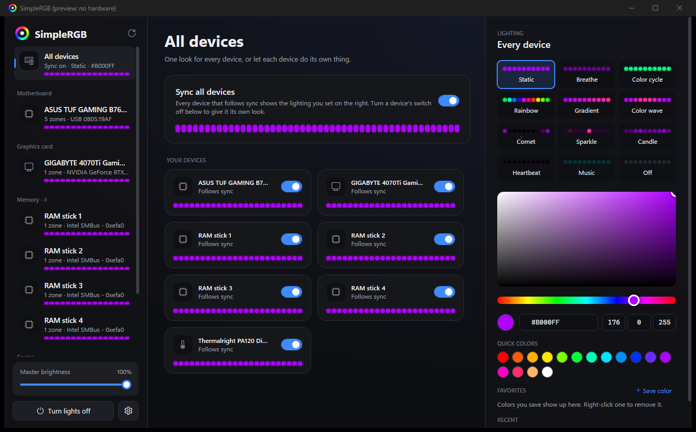
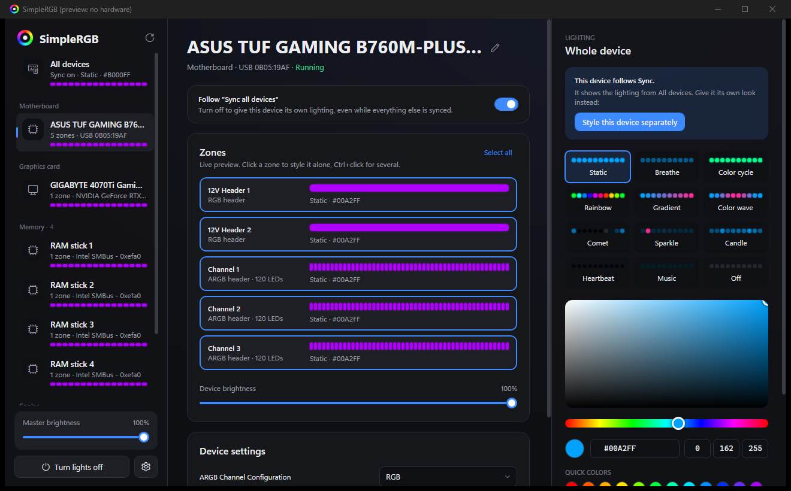
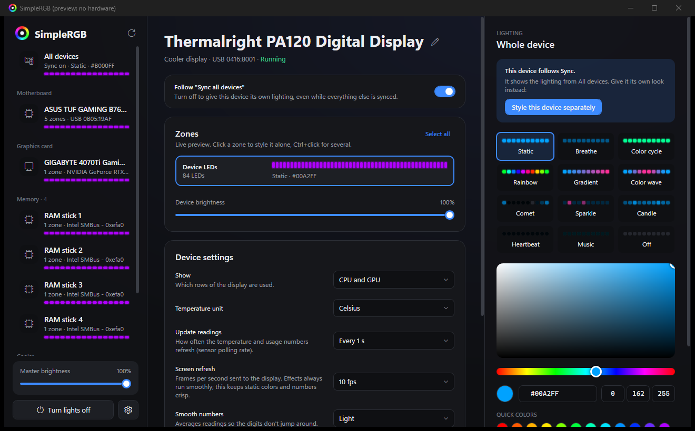

<div align="center">


# SimpleRGB

**Simple, lightweight, open-source RGB control for Windows.**
One small app for your motherboard, graphics card, RAM, cooler display and more, with live previews,
synced effects and Spotify music mode.

[](https://github.com/ItsMarwan/SimpleRGB/actions/workflows/ci.yml)
[](https://github.com/ItsMarwan/SimpleRGB/releases/latest)
[](LICENSE)




</div>

---

## Why SimpleRGB?

Most RGB suites are heavy, slow and full of accounts and ads. SimpleRGB is the opposite:

- ⚡ **Fast.** USB devices light up about one second after launch. It uses well under 1% CPU.
- 🎨 **Easy.** Pick a device, pick an effect, pick a color. Everything saves automatically.
- 🔗 **Synced for real.** Every device shares one clock, so rainbows and breathing effects move in step.
- 🧩 **Compatible.** It runs the device plugins from [SignalRGB](https://gitlab.com/signalrgb/signal-plugins)
  in a sandbox, so hundreds of devices work out of the box.
- 🛡️ **Safe by design.** No firmware writes. Your RAM's configuration chips are hard-locked. Plugins can't touch your system.
- 🆓 **Free and open source** (GPL-3.0). No account and no telemetry.

## Features

| | |
|---|---|
| **12 effects** | Static, Breathe, Color cycle, Rainbow, Gradient, Color wave, Comet, Sparkle, Candle, Heartbeat, Music, Off, with speed, width and direction controls |
| **Music mode** | Reacts to the **beat, bass, vocals or treble** of what you play. Colors can stay fixed, change every beat, follow the **album art**, or map to pitch. Pulse or equalizer style |
| **Spotify only** | Listens to Spotify alone (game or Discord audio won't trigger it) and shows the song that's playing |
| **Sync, your way** | "Sync all devices" gives everything one look; any device (e.g. your cooler display) can opt out and keep its own |
| **Per-zone control** | Every ARGB/RGB header, GPU, RAM stick and display can be styled on its own, with **live animated previews** |
| **Cooler display** | Thermalright *Digital* coolers (e.g. PA120 Digital) show **CPU/GPU temperature and usage** live: refresh rate, update interval, smoothing, temperature-based colors |
| **Color picker** | Color square, hue bar, hex and RGB input, quick colors, **favorites** and **recent colors** |
| **Tray and autostart** | Starts with Windows (no UAC prompt at login), restores your lighting, and stays out of the way in the tray |
| **Hot-plug and sleep** | Notices devices being plugged in or removed, and restores lighting after sleep |

<p align="center">
  
  
</p>

## Supported hardware

SimpleRGB supports anything with a **HID** or **SMBus** plugin from SignalRGB, plus its own built-in drivers:

| Type | Examples | How |
|---|---|---|
| Motherboards | ASUS Aura (USB), MSI, Gigabyte, ASRock… | SignalRGB HID plugins |
| Graphics cards | Gigabyte, ASUS, MSI, EVGA… (NVIDIA) | NVIDIA driver I2C, no extra driver needed |
| RAM | ENE/Aura-compatible (TeamGroup, G.Skill, ADATA…), Corsair, Kingston… | Intel SMBus via [PawnIO](https://pawnio.eu) |
| Cooler displays | Thermalright Digital (PA120 Digital family, `0416:8001`) | **Built-in** SimpleRGB driver |
| Keyboards, mice, AIOs, strips | Whatever SignalRGB's HID plugins cover | SignalRGB HID plugins |

The app lists any USB device it found but couldn't control (hover the note in the sidebar).
Raw-USB (libusb), serial and network plugins aren't supported yet.

> **AMD chipset RAM** (PIIX4) isn't supported yet. NVIDIA GPUs are; AMD GPU I2C isn't yet.

## Download and install

1. Download the latest **`SimpleRGB-…-win-x64.zip`** from [**Releases**](https://github.com/ItsMarwan/SimpleRGB/releases/latest).
   - `…-self-contained.zip` works on any Windows 10/11 PC.
   - The smaller zip needs the [.NET 8 Desktop Runtime](https://dotnet.microsoft.com/download/dotnet/8.0).
2. Extract it anywhere (e.g. `C:\Program Files\SimpleRGB` or `%LOCALAPPDATA%\Programs\SimpleRGB`) and run **`SimpleRGB.exe`**.
3. **Close other RGB apps** (SignalRGB, Armoury Crate, iCUE, TRCC…). Two apps writing to the same device makes it flicker.
   SimpleRGB warns you, and for some devices offers a button to close the other app.
4. Optional, for **RAM lighting**: install **[PawnIO](https://pawnio.eu)** (signed, open-source driver), then click
   **Restart as administrator** in SimpleRGB.
5. Optional: Settings → **Start with Windows**.

### Getting device plugins

SimpleRGB doesn't ship SignalRGB's plugins. It gets them on your PC:

- If **SignalRGB is installed**, its plugins are copied automatically (newest versions first).
- Otherwise, use **Settings → Plugins → Download from GitLab** (SignalRGB's public plugin repository).
- Your own or edited plugins go in `%APPDATA%\SimpleRGB\Plugins\Custom` and take priority.

## Safety

SimpleRGB talks to real hardware, so safety is built into the core instead of being left to plugins:

- **RAM configuration chips are unreachable.** On the motherboard SMBus, every transfer to the SPD EEPROM
  (`0x50–0x57`) and the SPD write-protect/page commands (`0x30–0x37`) is blocked before it reaches the hardware, and so are
  DDR5 power-management chips (`0x48–0x4F`, locked on DDR5). This is enforced in
  [`SmBusSafetyGuard`](src/SimpleRGB.Core/Hardware/SmBus/SmBusSafetyGuard.cs) and covered by tests.
- **No firmware or flash writes.** Only live color data is sent, which a reboot resets.
- **Sandboxed plugins.** Plugins run in [Jint](https://github.com/sebastienros/jint) with no file, network,
  process or .NET access; runaway scripts are stopped by a timeout.
- **Plays nice with other tools.** SMBus access holds the system-wide `Access_SMBUS.HTP.Method` mutex
  (shared with HWiNFO, LibreHardwareMonitor and others).
- **Fans are never touched.**
- The cooler display driver keeps the manufacturer's **40% brightness cap**, and pauses whenever the vendor app runs.

More in [docs/SAFETY.md](docs/SAFETY.md).

> SimpleRGB is an independent project, not affiliated with SignalRGB, ASUS, NVIDIA, Thermalright, Spotify or any
> hardware vendor. Like any software that talks to hardware, it comes with **no warranty**: see the [license](LICENSE).

## Build from source

Requirements: Windows 10/11 x64 and the [.NET 8 SDK](https://dotnet.microsoft.com/download/dotnet/8.0).

```powershell
git clone https://github.com/ItsMarwan/SimpleRGB.git
cd SimpleRGB
dotnet test tests/SimpleRGB.Tests      # 80+ tests, no hardware needed
dotnet run --project src/SimpleRGB     # run the app
powershell -ExecutionPolicy Bypass -File install.ps1   # Release build + Start menu shortcut
```

Handy for development:

```powershell
dotnet run --project src/SimpleRGB -- --preview          # UI with virtual devices, never touches hardware
dotnet run --project tools/SimpleRGB.Probe -- list       # read-only: devices, matching plugins, buses
dotnet run --project tools/SimpleRGB.Probe -- sensors    # live CPU/GPU temperature and load
```

## Documentation

| Doc | What's inside |
|---|---|
| [docs/ARCHITECTURE.md](docs/ARCHITECTURE.md) | How the pieces fit: device threads, plugin runtime, buses, effects, audio |
| [docs/PLUGIN_API.md](docs/PLUGIN_API.md) | The plugin API SimpleRGB implements, plus SimpleRGB extensions (`sensors`, `setMinimumFrameRate`…) |
| [docs/SAFETY.md](docs/SAFETY.md) | Hardware safety rules and how they're enforced |
| [CONTRIBUTING.md](CONTRIBUTING.md) | Adding devices, coding style, pull requests |
| [AGENTS.md](AGENTS.md) and [`.claude/skills/`](.claude/skills) | Guides for AI coding agents working on this repo |

## FAQ

**My lights flicker.** Another RGB app is running. Close it, and check its tray icon too.

**My device isn't found.** Make sure plugins are installed (Settings → Plugins). If it's listed under "USB devices
without an RGB plugin", nobody has written a plugin for it yet. [Open a device request](https://github.com/ItsMarwan/SimpleRGB/issues/new/choose).

**RAM isn't found.** Install [PawnIO](https://pawnio.eu) and run SimpleRGB as administrator. Intel chipsets only, for now.

**The GPU is missing after boot.** SimpleRGB retries automatically for about a minute in case the driver wasn't ready yet.

**Where are my settings and logs?** `%APPDATA%\SimpleRGB\settings.json` and `%APPDATA%\SimpleRGB\logs\simplergb.log`.
Please attach the log to bug reports.

## Credits

- [SignalRGB](https://signalrgb.com) for its open plugin ecosystem (plugins are downloaded on the user's PC, not redistributed)
- [Jint](https://github.com/sebastienros/jint) (BSD-2) for the JavaScript sandbox
- [NAudio](https://github.com/naudio/NAudio) (MIT) for audio capture and FFT
- [PawnIO](https://pawnio.eu) for the signed driver and the `SmbusI801` / `IntelMSR` modules (LGPL-2.1, [license](src/SimpleRGB.Core/Assets/PawnIO/COPYING.PawnIO.Modules.txt))
- [OpenRGB](https://gitlab.com/CalcProgrammer1/OpenRGB) for documenting NVIDIA I2C access

## License

SimpleRGB is free software under the [GNU General Public License v3.0](LICENSE).
